<p align="center">
  
</p>

<h1 align="center">react-native-skia-chart</h1>

<p align="center">
  Charts for Expo and React Native that are drawn on the GPU with Skia, animated on the UI thread, and easy for you or your coding agent to get right first time.
  <br />
  <a href="https://baraa-rasheed.github.io/react-native-skia-chart/"><b>Docs</b></a> ·
  <a href="https://baraa-rasheed.github.io/react-native-skia-chart/docs/agents">Agent guide</a> ·
  <a href="example">Example app</a>
</p>

---

Most React Native chart libraries draw SVG through the bridge. This one draws every bar, slice and candle with `react-native-skia` 3.8 (Metal on iOS, Vulkan on Android). Scrubbing, selection and pinch-zoom run as Reanimated worklets. Your finger moves the cursor without a React re-render on each frame.

```tsx
import { LineChart } from 'react-native-skia-chart';

<LineChart
  data={prices}
  width={340}
  height={200}
  fill
  gradient={{ type: 'linear', colors: ['#5EE7DF', '#B490CA'] }}
  onScrub={(p) => p && setPrice(p.y)}
/>
```

## Charts

Click a chart to open its docs page.

<table>
  <tr>
    <td align="center" width="33%"><a href="https://baraa-rasheed.github.io/react-native-skia-chart/docs/charts/line">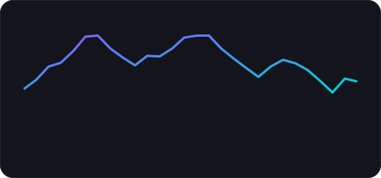<br /><b>Line</b></a></td>
    <td align="center" width="33%"><a href="https://baraa-rasheed.github.io/react-native-skia-chart/docs/charts/area">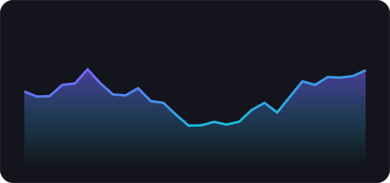<br /><b>Area &amp; Sparkline</b></a></td>
    <td align="center" width="33%"><a href="https://baraa-rasheed.github.io/react-native-skia-chart/docs/charts/bar">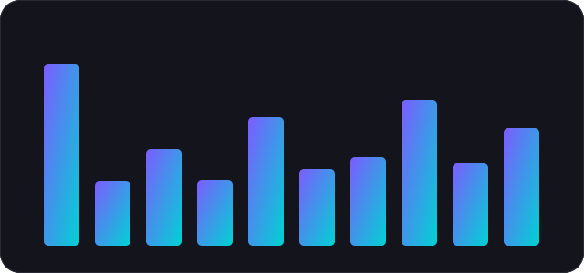<br /><b>Bar</b></a></td>
  </tr>
  <tr>
    <td align="center" width="33%"><a href="https://baraa-rasheed.github.io/react-native-skia-chart/docs/charts/stacked-bar">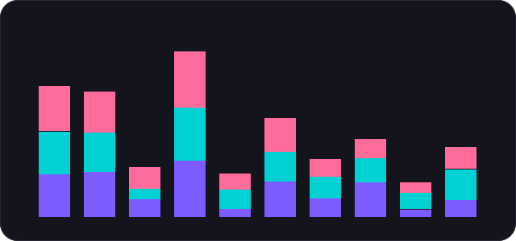<br /><b>Stacked bar</b></a></td>
    <td align="center" width="33%"><a href="https://baraa-rasheed.github.io/react-native-skia-chart/docs/charts/histogram">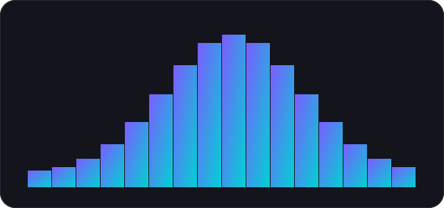<br /><b>Histogram</b></a></td>
    <td align="center" width="33%"><a href="https://baraa-rasheed.github.io/react-native-skia-chart/docs/charts/stacked-area">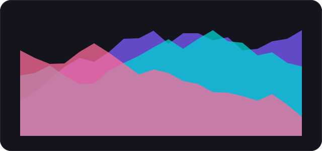<br /><b>Stacked area</b></a></td>
  </tr>
  <tr>
    <td align="center" width="33%"><a href="https://baraa-rasheed.github.io/react-native-skia-chart/docs/charts/pie-donut">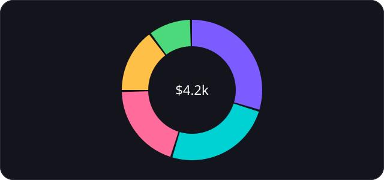<br /><b>Pie &amp; Donut</b></a></td>
    <td align="center" width="33%"><a href="https://baraa-rasheed.github.io/react-native-skia-chart/docs/charts/scatter">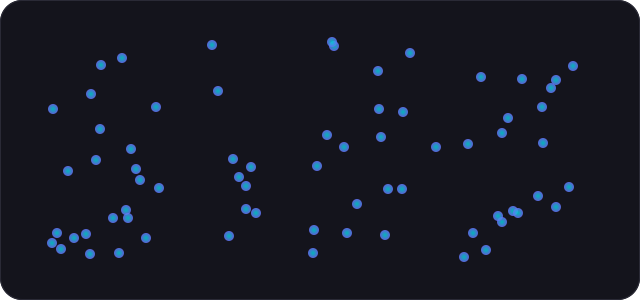<br /><b>Scatter</b></a></td>
    <td align="center" width="33%"><a href="https://baraa-rasheed.github.io/react-native-skia-chart/docs/charts/bubble">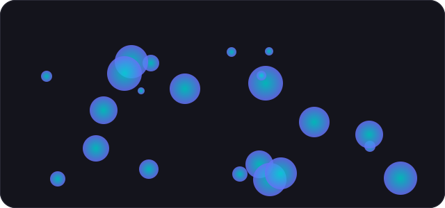<br /><b>Bubble</b></a></td>
  </tr>
  <tr>
    <td align="center" width="33%"><a href="https://baraa-rasheed.github.io/react-native-skia-chart/docs/charts/radar">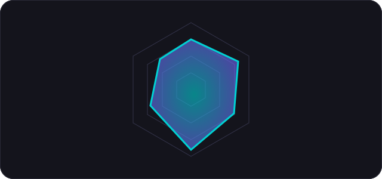<br /><b>Radar</b></a></td>
    <td align="center" width="33%"><a href="https://baraa-rasheed.github.io/react-native-skia-chart/docs/charts/candlestick">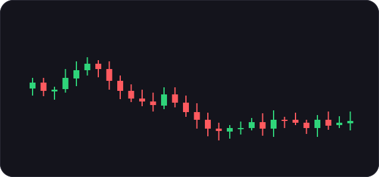<br /><b>Candlestick &amp; OHLC</b></a></td>
    <td align="center" width="33%"><a href="https://baraa-rasheed.github.io/react-native-skia-chart/docs/charts/heatmap">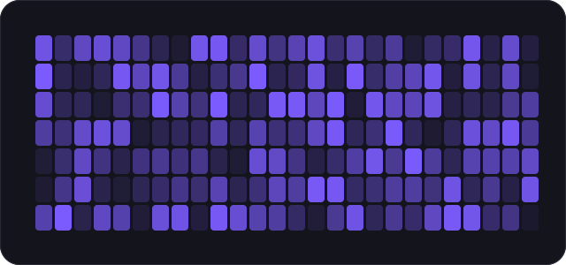<br /><b>Heatmap</b></a></td>
  </tr>
  <tr>
    <td align="center" width="33%"><a href="https://baraa-rasheed.github.io/react-native-skia-chart/docs/charts/gauge">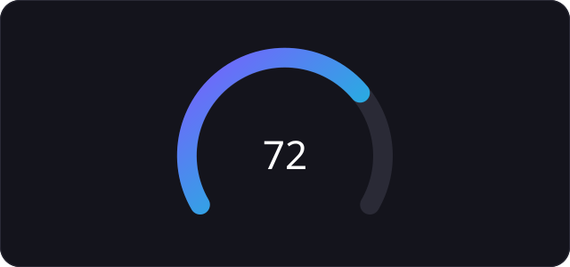<br /><b>Gauge</b></a></td>
    <td align="center" width="33%"><a href="https://baraa-rasheed.github.io/react-native-skia-chart/docs/charts/progress-rings">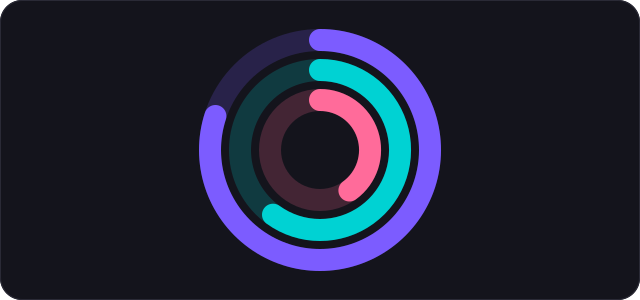<br /><b>Progress rings</b></a></td>
  </tr>
</table>

## What you get

- **Touch:**
  - Scrub or use a crosshair on line, area and candle charts.
  - Tap or long-press to select a bar, slice, point, cell or ring.
  - Pinch, pan or double-tap to zoom any chart with axes.
  - [Interaction docs](https://baraa-rasheed.github.io/react-native-skia-chart/docs/interaction).
- **Looks:**
  - Linear, radial and sweep [gradients](https://baraa-rasheed.github.io/react-native-skia-chart/docs/gradients).
  - Shadows, glow, blur, blend modes, dashes and SkSL shaders through one [`effects`](https://baraa-rasheed.github.io/react-native-skia-chart/docs/effects) prop.
- **Same props everywhere:** every chart takes pixel `width`/`height`, plain-array data, and the same `gradient`, `effects` and `animation` props. Learn one chart and you know the rest.

## Works with coding agents

The API is small and regular on purpose, so an LLM can't easily guess it wrong.

- [`AGENTS.md`](AGENTS.md) ships in the npm package. Cursor, Claude Code, Copilot and others read it automatically. It covers which chart to pick, the rules, and one canonical snippet.
- [`llms.txt`](https://baraa-rasheed.github.io/react-native-skia-chart/llms.txt) and an [agent guide](https://baraa-rasheed.github.io/react-native-skia-chart/docs/agents) are published with the docs.
- [`example/recipes/agent-recipes.tsx`](example/recipes/agent-recipes.tsx) has one recipe per chart, compiled under strict TypeScript alongside the example app, so the snippets stay correct.

## Install

```sh
npx expo install react-native-skia-chart react-native-skia react-native-reanimated react-native-worklets react-native-gesture-handler
```

You need `react-native-skia` ≥ 3.8, Reanimated ≥ 4 and worklets ≥ 0.7. It needs a dev build (not Expo Go) and Android `minSdkVersion` 26.

## Example app

A stocks-style home screen with every chart embedded full width. Tap **See All** on a chart to tweak colours, gradients, effects and interactions live in a native blur sheet.

```sh
cd example && npm install && npx expo run:ios   # or run:android
```

## Releasing to npm

Publishing is automated by [`.github/workflows/publish-npm.yml`](.github/workflows/publish-npm.yml). It runs when a GitHub Release is published or a `v*` tag is pushed, then type-checks, builds and runs `npm publish --access public`.

One-time setup:

1. On npmjs.com go to **Access Tokens → Generate New Token → Granular Access Token**. Give it **Read and write** permission on packages (scope it to `react-native-skia-chart` once the package exists, or all packages for the first publish) and tick **Bypass two-factor authentication**.
2. In this repo go to **Settings → Secrets and variables → Actions → New repository secret**. Name it `NPM_TOKEN` and paste the token.

Each release:

1. Bump `version` in `package.json` (for example `npm version patch`) and push to `main`.
2. Create a GitHub Release (or push a tag) named `v` + that version, e.g. `v0.2.0`. The workflow fails if the tag and `package.json` disagree, and skips versions already on npm.

You can also publish the current `package.json` version by hand from **Actions → Publish to npm → Run workflow**.

You can also publish the current `package.json` version by hand from **Actions → Publish to npm → Run workflow**.

## License

MIT
